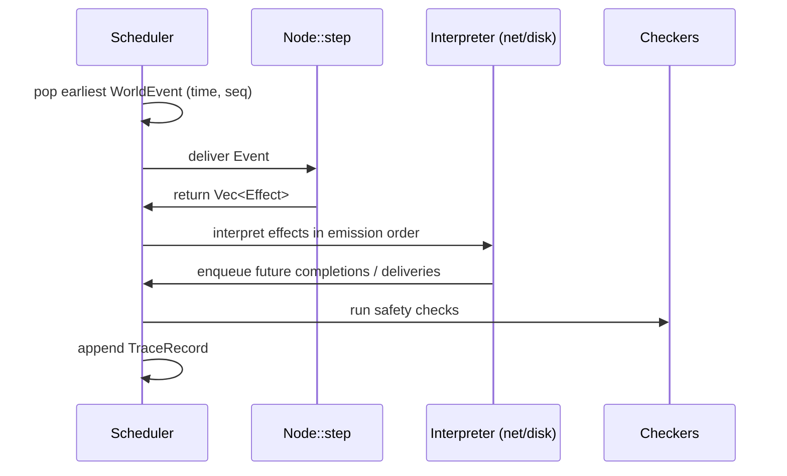

# Architecture (lock before code)

This is the **constitution** for Chronos. Changing a locked decision after Phase 3 is a rewrite. Changing a listed extension is not.

**Amended 2026-08-18** after a spec self-audit: timer ownership, torn-write reachability, persist-before-send scope, HashMap crate coverage, scheduler keys, WAL/CRC, effect reordering, and enforcement gates are now locked below rather than left as "pick one later."

**Companion docs:** [01-understanding.md](01-understanding.md) (why), [03-research.md](03-research.md) (sources), [00-project-guide.md](00-project-guide.md) (phases and interview bank), [roadmap/README.md](roadmap/README.md) (goals and step-by-step work). Where this file and the original guide disagree, **this file wins**.

---

## How to read this document

| If you want… | Start here |
|--------------|------------|
| The one-sentence pitch | [Verdict](#verdict) |
| A mental model before details | [Big picture](#big-picture) |
| What to implement first | [Phase mapping](#phase-mapping-so-the-roadmap-does-not-fight-the-architecture) |
| The API contract (`Event` / `Effect`) | [The step function](#the-step-function-core-product-api) |
| Why we rejected Tokio / sync traits | [Locked decisions](#locked-decisions) |
| What not to build in v1 | [Explicit non-goals](#explicit-non-goals-v1) |

Read [01-understanding.md](01-understanding.md) first if terms like DST, linearizability, or persist-before-send are unfamiliar.

---

## Verdict

Build a **three-crate hexagonal system** whose core is a pure step function. Own the event loop. Do **not** put Tokio, MadSim, or Turmoil under the protocol. Model I/O as **submitted work + later completion events**, not as synchronous `write()`/`send()` inside Raft. Time is **tickless `u64` nanoseconds**. Storage records are **length-prefixed and checksummed** from day one. Default faults are crash / torn-tail / loss / delay / reorder / partition. **Fsync-lies stay off** until we implement protocol-aware recovery.

### The decision that prevents a Phase-4 rewrite

> **Raft never blocks on I/O.** It emits effects. The harness may crash between any two effects, and may delay or reorder **completions** of independent I/O. It must not reorder two `Append`s to the same node's WAL relative to emission order. Persist-before-send is an observable ordering on **vote and vote-grant** (and persist-before-ack on successful `AppendEntries` replies), not a blanket ban on `Send` in the same batch as `IoSubmit`.

Everything else in this document unpacks that sentence.

---

## Big picture

Chronos is not "Raft in Rust." It is **Raft as a pure function** that two different runtimes interpret:

```text
                         ┌─────────────────────────────────────┐
                         │         composition roots            │
                         │   chronos-sim        chronos-node    │
                         │   (deterministic)    (OS I/O)        │
                         └──────────────┬──────────────┬────────┘
                                        │              │
           inbound adapters              │              │  inbound adapters
           (scheduler, faults,           │              │  (TCP, CLI, timers)
            simulated clients)           │              │
                                        ▼              ▼
                         ┌─────────────────────────────────────┐
                         │   inbound port = Node::step         │
                         │   (State, Event) -> Vec<Effect>     │
                         │         chronos-protocol            │
                         └──────────────────┬──────────────────┘
                                            │ effects = outbound port
                                            ▼
                         ┌─────────────────────────────────────┐
                         │   outbound adapters (interpreters)  │
                         │  sim: queued net/disk/timer/entropy │
                         │  node: mio/files/SystemTime/rng     │
                         └─────────────────────────────────────┘
```

### One simulation tick (the product loop)



1. Pick a **seed** → initialize one PRNG. All "random" choices (delays, drops, election timeouts) come from it.
2. A **single-threaded scheduler** holds a priority queue of world events.
3. Pop the earliest event, set virtual **now** to its timestamp, call `step(node, event) → effects`.
4. **Interpret** effects: queue delayed network delivery, mutate sim disk, schedule timer fires.
5. **Check** Raft safety after every event; check linearizability at end of run.
6. On failure: dump **seed + SHA-256(trace) + violating check**. Replay the seed on the same commit → same failure.

Raft is the protocol under test. The KV store is the demo application. **The replayable schedule is the product.**

### What "hexagonal" means here

Classic hexagonal architecture: the use case does not *call* outbound ports; it *returns* them as effects. Interpreters are the adapters.

| Layer | Role | Crate |
|-------|------|-------|
| Domain + protocol | Pure state transitions | `chronos-protocol` |
| Sim interpreter | Fake world for fuzzing | `chronos-sim` |
| Prod interpreter | Real files / sockets / clock | `chronos-node` |

This is the FoundationDB `INetwork` / `IAsyncFile` split — without pretending Raft is an async Rust service.

---

## Crate layout

**Do not add a fourth crate until it hurts.**

```text
chronos/
  Cargo.toml                  # workspace
  crates/
    chronos-protocol/         # domain + Raft + KV apply + Event/Effect types
    chronos-sim/              # scheduler, PRNG, sim net/disk, checker, fuzz, minify
    chronos-node/             # production interpreters + binary
  docs/
  clippy.toml                 # disallowed HashMap/Instant/fs/net/thread
```

### Dependency rule

Cargo enforces the crate graph; **Clippy + CI grep enforce what Cargo cannot:**

```text
chronos-protocol  ←── chronos-sim
       ↑
       └────────── chronos-node

sim and node NEVER depend on each other
```

| Crate | May depend on | Must NOT import |
|-------|---------------|---------------|
| `chronos-protocol` | `std` only (+ tiny CRC if not hand-rolled) | `std::net`, `std::fs`, `std::thread`, `std::time::Instant`, `std::time::SystemTime`, `HashMap`, `HashSet` |
| `chronos-sim` | `chronos-protocol` | `HashMap`, `HashSet` (iteration order = determinism bug) |
| `chronos-node` | `chronos-protocol` | `HashMap` only for OS connection tables that never iterate into protocol state or hashed traces |

If `chronos-protocol` imports banned types, that is a **build-breaking bug** — even though Cargo would happily compile it.

### Source tree (protocol)

Feature-first and boring:

```text
src/
  lib.rs                 # re-exports; no I/O
  types.rs               # NodeId, Term, Index, RequestId, Timestamp(u64 ns)
  event.rs               # Event enum (what the world does to a node)
  effect.rs              # Effect enum (what a node asks of the world)
  raft/
    state.rs             # persistent + volatile + in-flight I/O
    step.rs              # the only state transition function
    log.rs               # append-only log + matching
    election.rs          # timeouts, votes, role
    replication.rs       # AppendEntries, nextIndex, matchIndex, commit rule
  kv/
    machine.rs           # apply(entry) -> response; idempotency table
  wal/
    record.rs            # length + crc32 + payload (used by both sim and node)
  codec.rs               # deterministic binary encoding for messages and WAL
```

### Source tree (sim)

No `interfaces/` folder with one implementation. No DI container. Composition lives in `cluster.rs` and `main.rs`.

```text
src/
  rng.rs                 # single seeded PRNG (ChaCha or Xoshiro, integer only)
  scheduler.rs           # min-heap keyed by (Timestamp, Seq)
  net.rs                 # delay/loss/dup/reorder/partition
  disk.rs                # per-node buffer + durable watermark + fault knobs
  cluster.rs             # N nodes, dispatch Event to Node::step, interpret Effects
  trace.rs               # structured events; SHA-256; dump on failure
  check.rs               # five Raft safety properties
  history.rs             # client invoke/ok/fail for linearizability
  fuzz.rs                # swarm: seed → config → run
  minify.rs              # delta-debug the trace / fault schedule
```

---

## The step function (core product API)

```rust
struct Node { /* raft + kv + in-flight io */ }

fn step(node: &mut Node, event: Event) -> Vec<Effect>
```

Properties:

- **Synchronous** — no hidden awaits inside Raft.
- **Single-threaded per node** — concurrency is many nodes in one scheduler loop.
- **No clock, no RNG** — `step` does not take `now` and never calls an RNG.
- **Allocation-honest** — effects are explicit; I/O is never "already done."

Timers are `ArmTimer { kind }`. The **interpreter** picks duration and deadline. Protocol code never computes an absolute timestamp.

Apply happens **inside** `step` when `commitIndex` advances. There is no `Effect::Apply`. The harness snapshots `last_applied` after `step` for checkers and the trace.

### Events (world → node)

What the outside world can do to a node:

```text
enum Event {
    TimerFired { timer: TimerId },
    MessageReceived { from: NodeId, msg: Message },
    IoComplete { id: IoId, result: Result<(), IoError> },
    Recover { durable: Vec<u8> },   // durable WAL prefix after crash
    ClientRequest { req: ClientReq },
}

struct ClientReq {
    client: ClientId,
    request: RequestId,
    cmd: Cmd,                   // Get | Put | ...
}
```

**Crashes, partitions, and heals are world events**, not node events. The cluster harness applies them:

- **Crash** — discard volatile state and in-flight I/O for that node.
- **Recover** — deliver `Event::Recover` with whatever the sim disk (or real file) still considers durable.

On `Recover`, the node increments its I/O **incarnation** and resets the per-incarnation `IoId` counter. The harness **must** drop all in-flight I/O for that node on crash. Completions whose incarnation does not match are ignored. This prevents a late `IoComplete` from aliasing a post-restart submit.

### Effects (node → world)

What a node asks the world to do:

```text
enum Effect {
    Send { to: NodeId, msg: Message },
    IoSubmit { id: IoId, op: IoOp },
    ArmTimer { id: TimerId, kind: TimerKind },
    CancelTimer { id: TimerId },
    Reply { to: ClientId, request: RequestId, resp: ClientResp },
}

enum TimerKind { Election, Heartbeat }

enum IoOp {
    Append { bytes: Vec<u8> },  // one or more complete WAL records, emission order
    Fsync,
}

struct IoId {
    incarnation: u64,
    local: u64,
}
```

**Who assigns IDs:**

| ID | Assigned by | Why |
|----|-------------|-----|
| `MsgId` | Harness (at enqueue) | Needed for trace minimization; not on `Send` effect |
| `IoId`, `TimerId` | Node | Completions and firings must match what `step` is waiting on |
| `ClientId`, `RequestId` | Client | Idempotency and linearizability checking |

### Walkthrough: election timeout without blocking

When a follower's election timer fires, `step` must **not** send `RequestVote` until the vote metadata is durable. A simplified sequence:

```text
Event:  TimerFired(Election)
Effect: [ IoSubmit(Append Meta{term, votedFor}), IoSubmit(Fsync) ]
        (no Send yet)

Event:  IoComplete(Fsync, Ok)
Effect: [ Send(RequestVote) ... ]

--- harness may crash anywhere above ---
```

If the harness crashes after `IoSubmit` but before `IoComplete`, the node restarts from the durable prefix. If it crashes after `IoComplete` but before `Send`, the vote may not have been sent — safe. If it crashes after `Send` but the vote was never persisted, the checker catches a persist-before-send violation.

### Walkthrough: leader replication (Send + IoSubmit in same batch is legal)

A leader may append an entry and immediately `Send` `AppendEntries` to followers in the **same effect batch**:

```text
Effect: [ IoSubmit(Append Entry), Send(AppendEntries) ... ]
```

That is legal. What is **not** legal: the leader counting itself toward `matchIndex` / commit before its own append's `IoComplete(Ok)`.

### Persist-before-send (narrow, checkable)

A `Send` in the same effect batch as an `IoSubmit` is **legal** for log replication. The load-bearing invariants (sofa-jraft class):

1. **Persist-before-send (votes).** Do not `Send` `RequestVote` or a *granting* `RequestVote` response until `IoComplete(Ok)` has returned for a persist whose cookie covers that `(term, votedFor)`.
2. **Persist-before-ack (log).** Do not `Send` a successful `AppendEntries` response until `IoComplete(Ok)` has returned for a persist whose cookie covers the acked log prefix.

Each in-flight persist carries a cookie the checker can read:

```text
struct PersistCookie {
    term: Term,
    voted_for: Option<NodeId>,
    last_index: Index,
    last_term: Term,
}
```

Node state includes `in_flight: BTreeMap<IoId, PersistCookie>` and `durable: PersistCookie`. After `IoComplete(Ok)` of a `Fsync`, `durable` becomes that cookie. The checker compares outgoing vote/ack messages against `durable`, not against volatile state.

### Why not synchronous `Disk::write() -> Result`

That API cannot express:

- fsync still in flight while a vote RPC is on the wire,
- disk delay of 40ms during an election,
- crash between "buffer updated" and "durable watermark advanced,"
- reordering disk *completion* vs message delivery.

TigerBeetle and Dropbox Trinity both intercept **completions**. We start there.

Phase 1 (trivial WAL KV) already uses submit/complete, so the toy store teaches the real pattern. A sync trait for the toy would be thrown away at Phase 2.

---

## Time, entropy, and identity

| Concern | Rule |
|---------|------|
| **Time** | `Timestamp(u64)` nanoseconds, origin 0. Scheduler sets `now` to the popped event's timestamp. No ticks. Heap key is `(time, seq)` with `seq` a **single global** `u64` incremented at enqueue, never per-node, never reset within a run. Do not PRNG-shuffle a ready list. Jitter the *scheduled* time so ties are rare; `seq` still breaks remaining ties. |
| **Entropy** | One `Rng` in the sim. Delays, drops, which node the client hits, **and election-timeout durations** all from it. Heartbeat duration is a fixed config value. Protocol never calls RNG: `ArmTimer { kind: Election }` is interpreted as `at = now + rng_in_[T, 2T]`. |
| **Ids** | `NodeId(u8)` from config. `IoId { incarnation, local }` and `TimerId(u64)` from the node. `MsgId(u64)` from the harness at enqueue. `ClientId(u64)`, `RequestId(u64)` from the client. |
| **Collections** | `BTreeMap` / `BTreeSet` / `Vec` in **protocol and sim**. `HashMap` / `HashSet` is a determinism bug in either crate. |
| **Numbers** | No `f64` in protocol or in scheduled times. Delays are integer nanoseconds. |
| **Encoding** | Hand-rolled little-endian length-prefixed binary. No JSON. No `serde`. Codec must be identical on Windows/Linux. |

Production entropy (`getrandom`) and production time (`SystemTime`) live only in `chronos-node`. The node interpreter turns `ArmTimer { kind: Election }` into an OS deadline using its own RNG / config range — same contract, different entropy source.

### Scheduler fairness

No OS thread scheduling. Heap key is total: `(Timestamp, Seq)` where `Seq` is one global counter on the scheduler, incremented every enqueue (timers, deliveries, completions, crashes, client ops).

A per-node seq would bias same-time events by `NodeId` and would change order when cluster size changes. **Never do that.**

---

## Simulated world

Single thread. One priority queue of world events.

```text
loop:
  pop earliest WorldEvent                    # key = (time, global_seq)
  now = event.time
  apply to cluster (deliver / complete io / fire timer / crash / partition / client)
  if it targeted a node: effects = node.step(...)
  interpret effects in emission order:
    Append: apply to bytes immediately, enqueue completion
    Fsync / Send / ArmTimer: enqueue completion or delivery
  check invariants
  append structured TraceRecord              # no host clock, no paths
```

Phase 1 uses a simpler `drive()` loop (delay-0 `VecDeque`) before the full heap scheduler lands in Phase 2. The contract above is the target shape.

### Network model

| Behavior | How it works |
|----------|--------------|
| **Send** | Harness assigns `MsgId`, computes `delivery_at = now + delay_ns` (delay from PRNG, possibly 0) |
| **Drop / duplicate** | Per link policy, seed-driven |
| **Partition** | Adjacency matrix (symmetric by default; asymmetric is a flag). Drop if `!connected(from, to)` |
| **Reorder** | Falls out of per-message random delay. No special reordering data structure until a test needs it |
| **Crash of sender** | Messages already on the wire survive. Receiver may still get them. Raft terms make stale RPCs safe |
| **Crash of receiver** | Disk `IoComplete`s for that node do **not** survive |

### Disk model

Per node:

- `bytes: Vec<u8>` — the buffer the process sees,
- `durable_len: usize` — last fsync the sim decided succeeded,
- in-flight `IoOp`s with scheduled completion times.

**Rules:**

| Operation | Behavior |
|-----------|----------|
| `Append` | Mutates `bytes` immediately, **in emission order**. Does **not** move `durable_len`. Two `Append`s from one `step` are never reordered on that node's byte buffer |
| `Fsync` | Submitted against a **length-at-submit** snapshot `sync_len`. On `Ok`, `durable_len = max(durable_len, sync_len)`. A write issued after that fsync was submitted cannot sneak into it |
| Completions | `Append`, `Fsync`, and `Send` completions **may** be delayed and reordered relative to each other — that is the interleaving we test |

**Crash (honest durable prefix + torn suffix):**

1. Keep `bytes[0..durable_len]` intact.
2. Replace `bytes[durable_len..]` with a seed-chosen prefix of the in-flight `Append`s that had been applied to the buffer (0..=full pending tail). That prefix may end mid-record. This is the **torn tail**. It is **not** an fsync-lie: `durable_len` still means "fsync succeeded."
3. Drop in-flight I/O. Deliver `Recover`.

**Recover:** scan records from offset 0. Stop at first header that does not fit, or whose CRC fails. Truncate `bytes` (and `durable_len` if needed) to the end of the last good record. Then replay records into volatile Raft/KV state.

**Never in-place overwrite.** `(currentTerm, votedFor)` is a `Meta` record appended to the same WAL, not a separately-seeked header. Last `Meta` on recover wins. Log entries are `Entry` records.

### WAL record layout

Little-endian, identical in sim and node:

```text
[u32 payload_len][u32 crc32][payload]
```

`crc32` is CRC-32/ISO-HDLC (the zlib polynomial `0xEDB88320`) of `payload_len.to_le_bytes() || payload`. A torn `len` field fails the CRC or the "header does not fit" check.

### Fault knobs

All seed-driven, all recorded on the trace:

| Knob | Default fuzz | Notes |
|------|----------------|------|
| Delay I/O completions | on | Required for interleaving |
| Crash | on | |
| Torn suffix past `durable_len` | on | in-flight append prefix; CRC truncates |
| Fail fsync with Err | on | caller must not send vote/ack |
| Fail fsync with Ok but do not advance durable_len | **off** | lying firmware; needs PAR |
| Bitrot inside a durable record | off | needs replica repair |
| Misdirected write | off | PAR |

**Torn tail and fsync-lie are different knobs.** Torn tail mutates only `bytes[durable_len..]`. Fsync-lie reports success without moving `durable_len`.

---

## Raft vs KV (do not fuse them)

```text
Client -> (client_id, request_id, cmd) -> log entry -> replicate -> commit -> apply(KV)
```

| Concern | Rule |
|---------|------|
| Log payload | Opaque bytes plus the idempotency key |
| KV apply | If `request_id` already in that client's table, return the stored response (no second mutation). DDIA exactly-once semantics |
| Idempotency table | **State-machine state** inside `kv/machine.rs`. Updated only during apply. Covered by State Machine Safety. Unbounded in v1; bound sim length instead of inventing snapshots |
| Reads (v1) | **Log entries.** Serving `Get` from leader memory without read-index will fail linearizability under a deposed leader. Read-index is a later extension |
| New leader | Appends a **no-op** (or equivalent current-term entry) before committing old-term entries. Figure 8 is a checker case |
| Membership | Static cluster in v1. No membership change, no snapshots, no log compaction. Bound sim length so logs stay small |

Snapshots later must not change `step`'s Event/Effect vocabulary except by adding variants.

---

## Checkers (two independent oracles)

Run **after every world event** (cheap) plus **at end of run** (history).

### White-box (Raft safety)

After each event, inspect all nodes' in-memory logs and roles:

1. **Election Safety** — at most one leader per term
2. **Leader Append-Only** — leaders never overwrite or delete entries in their own log
3. **Log Matching** — if two logs share index+term, all preceding entries match
4. **Leader Completeness** — committed entries in term T appear in every later-term leader
5. **State Machine Safety** — applied[index] unique across nodes, including the KV idempotency table

**Engineering invariants** (catch bugs earlier):

- Persist-before-send / persist-before-ack (`durable` cookie vs outgoing vote/grant/AE-success)
- `commitIndex` never decreases
- A leader only counts replicas to commit entries with `entry.term == currentTerm`
- A leader does not advance its own `matchIndex[self]` for an entry until the corresponding `Fsync` has `IoComplete(Ok)`

### Black-box (KV linearizability)

Simulated clients record `{op, invoke (time, seq), complete (time, seq), result}` keyed by `(client, request)`. `Effect::Reply` carries `RequestId` so a late `NotLeader` cannot close an earlier in-flight op.

Happens-before is `(time, seq)`, not timestamp alone. At end (and on failure), check linearizability against a sequential map spec (Porcupine algorithm; small version for a register/map — state space is the map).

Failed/unknown ops (timeout after possible apply) stay in the history as incomplete. An unmatched `Reply` is a recorder error, not a silent drop.

**Do not** implement linearizability by comparing all KV maps every tick — partitions make them legally diverge on uncommitted data.

### Liveness (optional, separate flag)

If a majority remains fully connected for `T_ns = 10 * max_election_timeout` with no further crashes or partitions, a leader exists and a client write commits.

If that premise is false (window not elapsed, or no connected majority), the implication is vacuously true — do not fail. **Never enable this in a run that injects permanent partitions.**

---

## Fuzzing and minimization (product loop)

```text
seed → PRNG → swarm config → run → check → (on fail) trace + minimize
```

1. Seed → PRNG → swarm config: `n` in {3,5}, timeouts, delay distributions, fault probabilities, buggify flags, client rate.
2. Run until `max_ns` or invariant fail.
3. On fail: write `fail-<seed>.trace`, print seed, hash, first violating check.
4. CI: run seed twice at the start of every sim test (`assert_eq!(hash(run(s)), hash(run(s)))`). Then N random seeds.
5. Minimize: delta-debug the **fault/delivery schedule** (the extra world events), not "randomly delete Raft internals." Re-run from seed with a filtered schedule, or replay a recorded event list if the recorder is complete. Prefer recording the schedule (drops, partitions, crashes, completion order) so replay does not need the PRNG to make the same choices after a deletion.

**Trace hash:** SHA-256 of the concatenation of little-endian encoded `TraceRecord`s. No wall clock, hostname, path, or `std::hash::Hasher` (toolchain-unstable). Same seed + same commit ⇒ same digest on Windows and Linux.

**Buggify** (legal weirdness): extra delay on an otherwise-fast fsync; reject an RPC that could have been accepted; election timeout at the extreme of the legal range. Correctness must not depend on "fsync is always faster than the election timer."

**Fault rates:** keep a mode that is *mostly healthy*. A 90% drop rate only explores "no leader." Swarm should mix calm and brutal runs (FDB).

---

## Production node (so sim is not a cousin)

`chronos-node` interprets the same `Effect`s:

| Effect | Production interpreter |
|--------|------------------------|
| `Send` | Write on length-prefixed TCP (or later QUIC; do not care in v1) |
| `IoSubmit` | `pwrite` / `FlushFileBuffers` (Windows) / `fdatasync` (Linux). Same WAL record format |
| `ArmTimer` | OS timer or local wheel keyed off `SystemTime` — **only here** |
| Completions | Become `Event`s on a single-threaded loop (`mio` or simple `select`) |

Election duration still comes from a range in the node interpreter, not from protocol code. Still no thread-per-node inside the protocol.

v1 production can be "single process, three nodes, real sockets" for a demo. Multi-machine is the same binary.

---

## Determinism audit (12 layers)

Mapped from agent-wrapper failure modes to this runtime. Any "yes" is a leak.

| # | Layer | What corrupts a Chronos run | Code gate |
|---|--------|-----------------------------|-----------|
| 1 | Config / "system prompt" | Hidden timeouts, magic sleeps, `thread::sleep` | Ban in protocol; `ArmTimer` only |
| 2 | Session history | Global RNG or process-wide HashMap seed leaking across runs | New `Rng` per seed; no globals |
| 3 | Long-term memory | Durable bytes from a previous seed still on a reused buffer | Fresh disks per run |
| 4 | Distillation | Pretty-printed traces re-parsed as truth | Typed records; SHA-256 those |
| 5 | Active recall | Re-reading wall clock inside `step` | No `Instant`; no `now` arg |
| 6 | Tool selection | Sim accidentally calling real FS | crate graph |
| 7 | Tool execution | "We sent" without an Effect; hallucinated persist | effects are the only I/O |
| 8 | Tool interpretation | Ignoring `IoComplete` Err and sending a vote anyway | persist-before-send check |
| 9 | Answer shaping | Trace dump mutates order while formatting | dump is serialize(records) |
| 10 | Platform rendering | Windows vs Linux HashMap / endian / JSON | BTree in protocol **and** sim; LE codec |
| 11 | Hidden repair | Retry loop with real backoff inside protocol | retries are timers + events |
| 12 | Persistence | Using in-memory log after crash as if durable | Recover from durable prefix + CRC scan |

CI determinism test is the cheap detector. Do not wait for a Heisenbug.

---

## Locked decisions

Changing any row after Phase 3 is a rewrite.

| ID | Decision | Rejected alternative | Why the alternative bites later |
|----|----------|----------------------|--------------------------------|
| D1 | Rust | Go, Zig, C++ | Spec is trait-shaped; Zig is TB's world not ours; Go map iteration is also random and the interviewer expects Rust DST. |
| D2 | Own single-thread scheduler | Tokio + MadSim/Turmoil | Hides the step function; `cfg madsim` + getrandom patches; Windows-hostile; still leaks HashMap. |
| D3 | Effects + completions; persist-before-send/ack only for votes and AE-success | Sync `Disk`/`Network` traits; blanket "no Send with IoSubmit" | Sync cannot interleave crash with in-flight I/O. The blanket rule rejects legal leader `AppendEntries`. |
| D4 | Tickless `u64` ns; heap key `(time, global seq)` | Integer ticks + shuffle; per-node seq; PRNG among ties | TB already paid the tick rewrite. Per-node seq biases by `NodeId`. |
| D5 | Three crates | One crate "for now" | Sim will import `std::net` "just in a test" and poison protocol. |
| D6 | BTreeMap/BTreeSet/Vec in protocol **and** sim | Deterministic hasher; ban HashMap only in protocol | Sim iteration (net, disk, check, trace) is what D13 hashes. Hasher is easy to forget. |
| D7 | Get via log in v1 | Leader memory reads | False linearizability failures and a fake "DST found a bug." |
| D8 | Idempotency keys on every client op; table is SM state | Retry without keys; table as a side cache | "Bug" is the client protocol, not Raft. Divergent tables break State Machine Safety. |
| D9 | Checksummed append-only WAL from Phase 1; torn suffix is past `durable_len` | Raw byte buffer; torn write by shrinking `durable_len` | Format change later. Shrinking `durable_len` is an fsync-lie (D10). |
| D10 | Fsync-lie off by default | Always-on firmware lies | "Discovers" that paper Raft is unsafe (known). Pollutes Phase 7. |
| D11 | Static membership, no snapshots | Full Raft | Membership is a second protocol. Snapshots can wait until logs hurt. |
| D12 | Two checkers; apply inside `step` | Invariants only; optional `Effect::Apply` | KV can be wrong while Raft looks perfect. Optional Apply splits the oracle. |
| D13 | SHA-256 of encoded `TraceRecord`s as CI oracle | Eyeball logs; `std::hash::Hasher` | Hasher is toolchain-unstable. Host fields make Windows ≠ Linux. |
| D14 | Little-endian `[len][crc32(len\|\|payload)][payload]` | serde JSON / bincode; CRC over payload only | JSON object order; torn `len` is silent if CRC ignores it. |
| D15 | `ArmTimer { kind }`; harness owns durations and `now` | `SetTimer { at }`; `step(node, now, event)` | Protocol has no clock and no RNG. Absolute `at` forces both. |
| D16 | Clippy disallowed-types + CI grep | "Cargo will catch it" | Cargo only sees crate deps. `use std::fs` compiles. |
| D17 | WAL `Meta` + `Entry` records; Appends in emission order | In-place term/votedFor header; reorder Writes | In-place fights torn-tail. Reordered Appends scramble CRC boundaries. |

---

## Explicit non-goals (v1)

- Byzantine nodes
- Dynamic cluster membership
- Snapshots / log compaction
- Linearizable reads without going through the log
- Multi-datacenter / true clock drift
- Performance optimization of the production node
- A custom hypervisor
- Jepsen against real deploys (later complement, not a substitute)

---

## Phase mapping (so the roadmap does not fight the architecture)

The project guide's phases stay. Implementation *shape* is fixed now:

| Guide phase | What we actually build | Done when |
|-------------|------------------------|-----------|
| 1 Foundation | `Event`/`Effect`, WAL records (`Meta`/`Entry`), a **single-node** KV that only talks via step+effects; a **real** node interpreter *and* a stub sim interpreter | Swap interpreter without touching KV logic |
| 2 Simulator | Scheduler + global seq + PRNG + sim net + sim disk (torn suffix) + toy protocol (echo/ping is enough) | `hash(run(seed))` identical twice; test in CI |
| 3 Raft | Election + replication inside the same step function; no-op on leadership; KV apply; persist-before-send/ack | 3 nodes, no faults, one leader, logs match, KV Get/Put |
| 4 Faults | Partitions, loss, delay, crash/restart, torn tail, fsync Err | Scripted scenarios (partition leader; crash after persist-before-send) behave as predicted |
| 5 Properties | Five safety checks + persist-before-send/ack; plant `votedFor` not persisted | Planted bug fails; unplanted happy path passes |
| 6 Fuzz | Swarm seeds, headless, trace dump | 10k seeds on one machine is a goal, not a gate for starting |
| 7 Bug | Real violation or a documented near-miss with a planted production-class fault | Seed + minimized trace + root cause writeup |
| 8 Minify | Delta-debug schedule | 10k events → smallest subsequence |
| 9 Product | Coverage counters, CI seed batch, README scope | Merge blocked on new invariant fails |

**Do not** implement Raft in Phase 1. **Do not** add Tokio in Phase 2 "to go faster."

---

## What this architecture deliberately leaves on the table

If you want full-system DST of an unmodified binary, that is Antithesis/Hermit. If you want real kernel and NIC bugs, that is Jepsen/sinkhole. Chronos is the **co-designed** kind: like FoundationDB and TigerBeetle, the runtime exists so the protocol can be a function. That is the point of the exercise.
